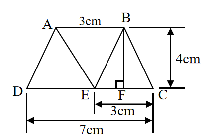
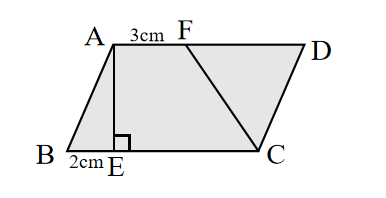

# AVP1199 — Single visual target

We-Math:1415 / We-Math:1125 · same type · Geometric markers

## Shared or similar visual information

A right-angle square.

## Evidence locations

- Left image: The small square at F at the foot of BF.
- Right image: The square at E where AE meets BC.

## Mathematical meanings

Left image: BF is perpendicular to the horizontal base DC. Right image: AE is perpendicular to BC.

## Same mathematical meanings

yes

## Rationales

Both images use the mark in the same way: a square placed in the angle between two segments marks those segments as perpendicular.

Only the selected target is annotated. AI visual-review draft; not independently double-annotated by humans.
