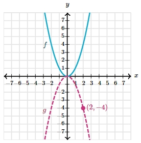

# AVP1200 — Single visual target

VisioMath:349_A / MathVerse:571 · different type · Geometric markers

[Left image in official archive](https://raw.githubusercontent.com/Nefefilibata/VisioMath/4a912153e110001da261917902e1d3cc163b7c6a/data/images.zip) · `images/349_A.jpg`

## Shared or similar visual information

A dashed curve.

## Evidence locations

- Left image: The dashed part of the bottom rim, behind the solid front arc.
- Right image: The dashed magenta downward-opening curve g.

## Mathematical meanings

Left image: The arc depicts the hidden rear part of the cylinder's lower rim. Right image: The curve is the graph of the function g, distinguished from the solid graph f.

## Same mathematical meanings

no

## Rationales

In the left image, the dashes trace an occluded portion of a circular rim in a solid diagram. In the right image, the dashed curve itself plots a function.

Only the selected target is annotated. AI visual-review draft; not independently double-annotated by humans.
