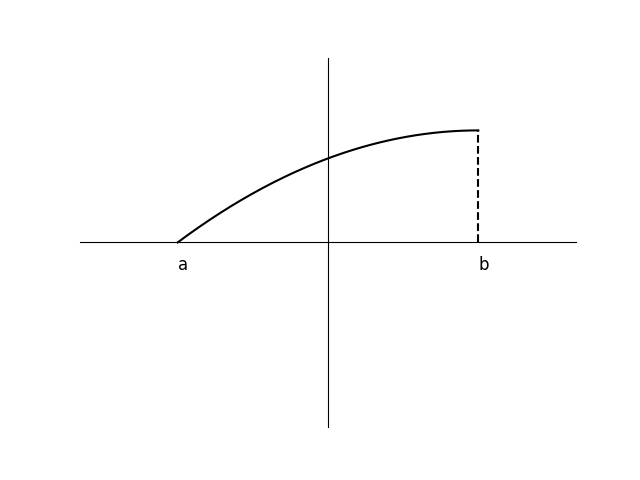
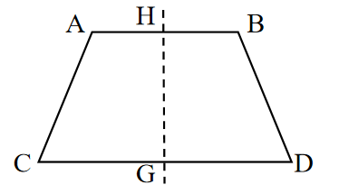

# AVP1201 — Single visual target

DynaMath:204 / We-Math:117 · different type · Geometric markers

## Shared or similar visual information

A vertical dashed line.

## Evidence locations

- Left image: The vertical dashed segment from the right endpoint down to b.
- Right image: The vertical dashed line HG through the center of the trapezoid.

## Mathematical meanings

Left image: The line projects the right endpoint of the curve onto horizontal coordinate b. Right image: The line is the symmetry axis of the trapezoid.

## Same mathematical meanings

no

## Rationales

In the left image, the vertical dashed segment projects a plotted position to its horizontal coordinate. In the right image, the dashed line is the axis used to reflect a geometric figure.

Only the selected target is annotated. AI visual-review draft; not independently double-annotated by humans.
