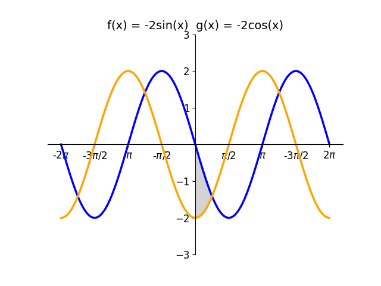
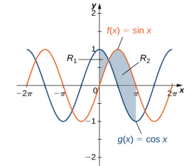

# AVP1202 — Single visual target

DynaMath:144 / MathVista:287 · same type · Domain and solution-set constraints

## Shared or similar visual information

A shaded patch between two curves on coordinate axes. On the left, use the gray patch underneath the horizontal axis between the blue and orange curves, immediately to the right of the vertical axis. On the right, use the shaded patch marked R2 between the orange sine and blue cosine traces at the right.

## Evidence locations

- Left image: The gray patch underneath the horizontal axis between the blue and orange curves, immediately to the right of the vertical axis.
- Right image: The shaded patch marked R2 between the orange sine and blue cosine traces at the right.

## Mathematical meanings

Left image: It selects the area between the two traces from the vertical axis to their first intersection on the right. Right image: It selects a region between the two functions on the displayed x-interval.

## Same mathematical meanings

yes

## Rationales

The fill selects the gap between the two plotted functions over a specific horizontal interval. The upper value minus the lower value gives the local height of that region.

## Reasoning consequence

Correctly interpreting the markings means using the difference between the traces and stopping at their intersection on the left and subtracting the lower graph from the upper graph over the displayed R2 interval on the right.

Only the selected target is annotated. AI visual-review draft; not independently double-annotated by humans.
