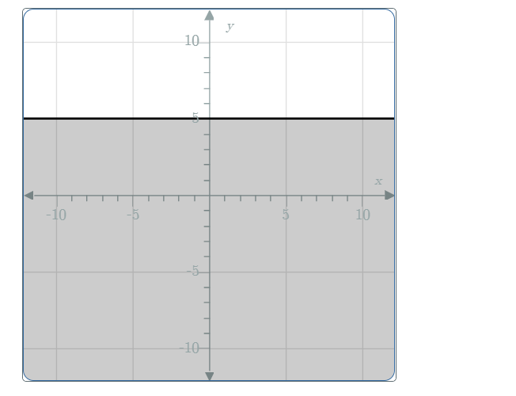

# AVP1203 — Single visual target

MathVerse:509 / DynaMath:64 · same type · Domain and solution-set constraints

## Shared or similar visual information

A shaded region adjacent to a plotted line or curve. On the left, use the gray half-plane below the solid horizontal line. On the right, use the gray area above the x-axis between the two branches of the parabola.

## Evidence locations

- Left image: The gray half-plane below the solid horizontal line.
- Right image: The gray area above the x-axis between the two branches of the parabola.

## Mathematical meanings

Left image: It consists of points satisfying the lower-side inequality, including equality along the solid line. Right image: The shading selects the bounded region between the parabola and the x-axis from x = −5 to x = 5, whose top extends beyond the window.

## Same mathematical meanings

no

## Rationales

The left fill identifies where a plotted comparison is satisfied. The right fill selects a region from a function to its axis over a specified integration interval.

## Reasoning consequence

Correctly interpreting the markings means including points on the boundary and below it in the solution set on the left and using the two zeros as the area bounds and including the portion cut off by the window on the right.

Only the selected target is annotated. AI visual-review draft; not independently double-annotated by humans.
