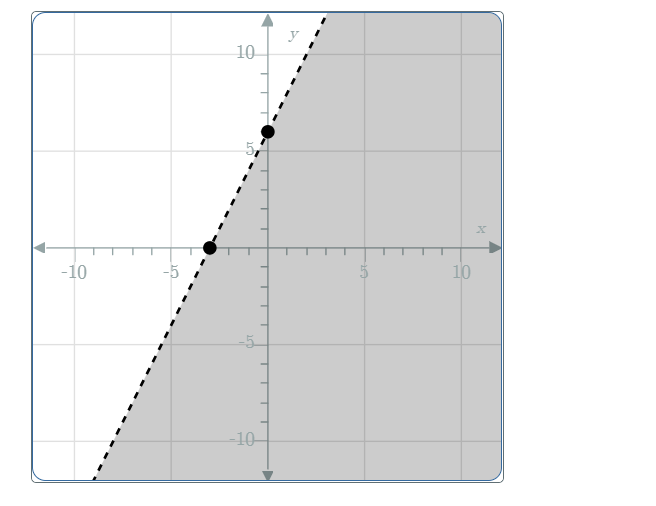
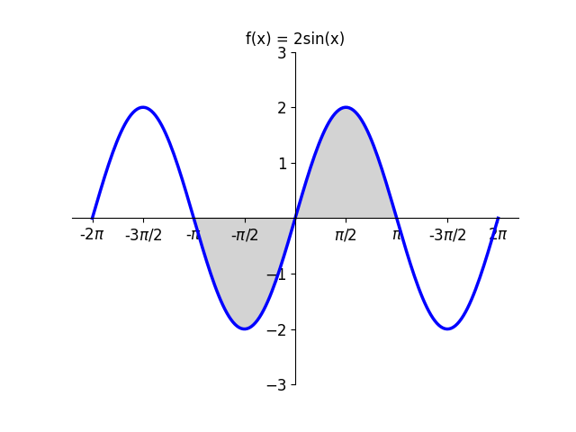

# AVP1205 — Single visual target

MathVerse:511 / DynaMath:77 · same type · Domain and solution-set constraints

## Shared or similar visual information

A shaded region adjacent to a plotted line or curve. On the left, use the gray side of the rising dashed line that contains the origin. On the right, use the gray positive lobe between the sine curve and the x-axis from 0 to π.

## Evidence locations

- Left image: The gray side of the rising dashed line that contains the origin.
- Right image: The gray positive lobe between the sine curve and the x-axis from 0 to π.

## Mathematical meanings

Left image: It marks the open half-plane of coordinate pairs satisfying the strict linear inequality. Right image: It selects the area bounded by the upper sine lobe and the horizontal axis.

## Same mathematical meanings

no

## Rationales

The left fill identifies where a plotted comparison is satisfied. The right fill selects a region from a function to its axis over a specified integration interval.

## Reasoning consequence

Correctly interpreting the markings means including the origin while excluding the points on the dashed line on the left and integrating over the positive lobe from 0 to π when calculating that part of the area on the right.

Only the selected target is annotated. AI visual-review draft; not independently double-annotated by humans.
