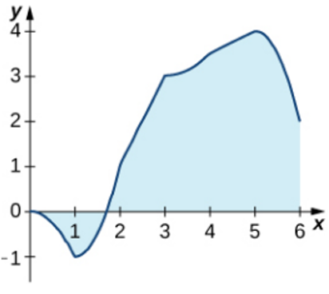

# AVP1206 — Single visual target

MathVerse:512 / MathVista:260 · same type · Domain and solution-set constraints

## Shared or similar visual information

A shaded region adjacent to a plotted line or curve. On the left, use the gray half-plane to the right of the descending dashed line through the origin. On the right, use the larger blue region above the x-axis from the positive crossing to the right edge at x = 6.

## Evidence locations

- Left image: The gray half-plane to the right of the descending dashed line through the origin.
- Right image: The larger blue region above the x-axis from the positive crossing to the right edge at x = 6.

## Mathematical meanings

Left image: It marks the open solution half-plane of a strict linear inequality. Right image: It selects the portion of the area measured between the upper curve and the x-axis over the indicated interval.

## Same mathematical meanings

no

## Rationales

The left fill identifies where a plotted comparison is satisfied. The right fill selects a region from a function to its axis over a specified integration interval.

## Reasoning consequence

Correctly interpreting the markings means excluding the origin because it lies on the dashed boundary on the left and using x = 6 as the right bound and separating the above-axis patch from the negative lobe on the right.

Only the selected target is annotated. AI visual-review draft; not independently double-annotated by humans.
