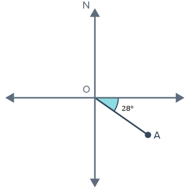
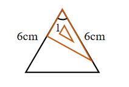

# AVP1207 — Single visual target

MathVerse:334 / We-Math:1146 · same type · Geometric markers

## Shared or similar visual information

A circular arc.

## Evidence locations

- Left image: The arc at O along the curved edge of the blue wedge.
- Right image: The short curved mark just inside the orange apex.

## Mathematical meanings

Left image: The arc marks the 28-degree angle between the east ray and OA. Right image: The arc identifies the triangle apex angle labeled 1.

## Same mathematical meanings

yes

## Rationales

Both images use the mark in the same way: the arc is drawn inside a vertex angle to show which angle is selected.

Only the selected target is annotated. AI visual-review draft; not independently double-annotated by humans.
