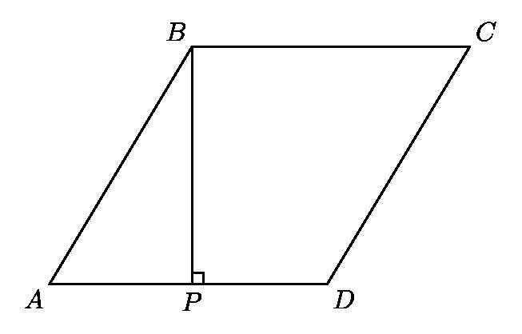

# AVP1208 — Single visual target

MathVision:2249 / We-Math:995 · same type · Geometric markers

## Shared or similar visual information

An unfilled square outline.

## Evidence locations

- Left image: The square at P at the foot of BP.
- Right image: The four-sided outline labeled A, B, C and D.

## Mathematical meanings

Left image: BP is perpendicular to the base AD. Right image: The outline represents the square ABCD as the geometric object.

## Same mathematical meanings

no

## Rationales

In the left image, a square placed in the angle between two segments marks those segments as perpendicular. In the right image, the outline itself bounds a square polygon.

Only the selected target is annotated. AI visual-review draft; not independently double-annotated by humans.
