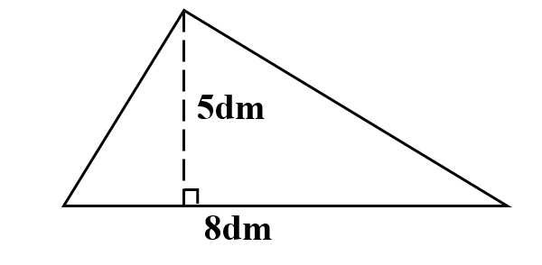
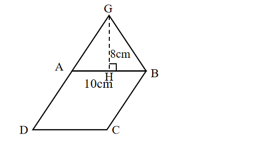

# AVP1211 — Single visual target

We-Math:225 / We-Math:1447 · same type · Geometric markers

## Shared or similar visual information

A vertical dashed line.

## Evidence locations

- Left image: The dashed line through the height label 5 dm.
- Right image: The vertical dashed segment GH labeled 8 cm.

## Mathematical meanings

Left image: The line represents the perpendicular altitude to the triangle base. Right image: The line represents the perpendicular height of triangle GAB.

## Same mathematical meanings

yes

## Rationales

Both images use the mark in the same way: a vertical auxiliary segment marks a perpendicular height relative to a geometric base.

Only the selected target is annotated. AI visual-review draft; not independently double-annotated by humans.
