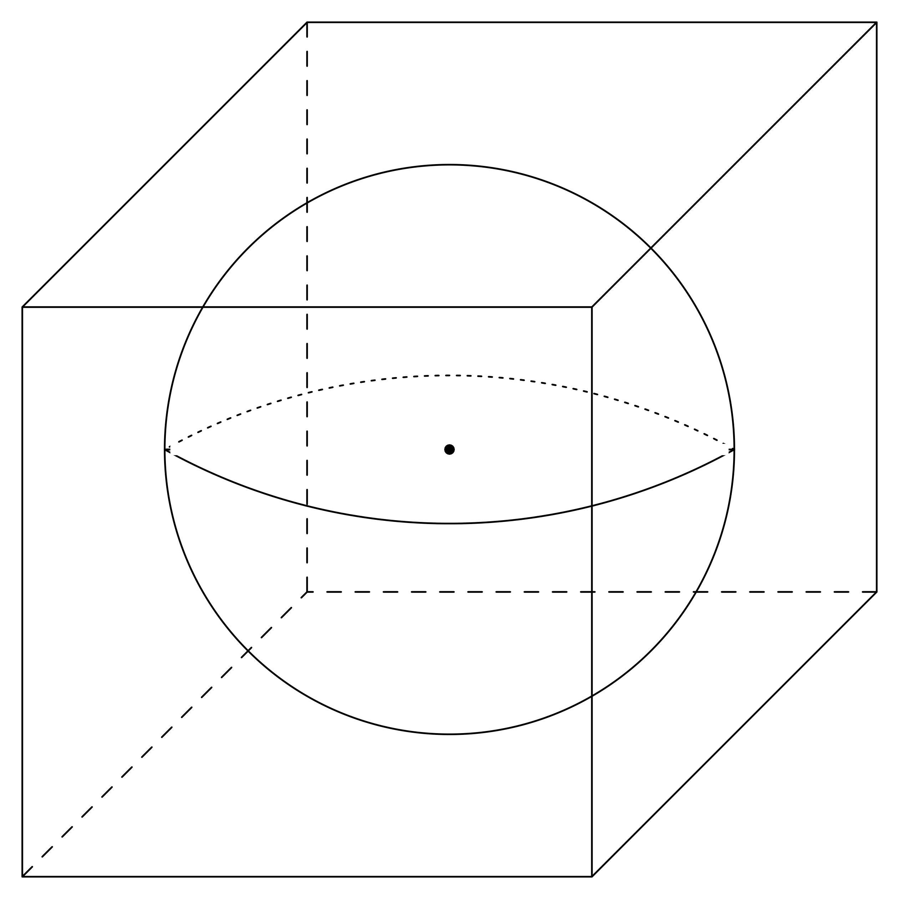

# AVP1212 — Single visual target

MathVerse:599 / MathVision:2942 · different type · Geometric markers

## Shared or similar visual information

A dashed curve.

## Evidence locations

- Left image: The dashed red S-shaped curve to the right of the solid blue curve.
- Right image: The dashed back portion of the ellipse drawn across the sphere.

## Mathematical meanings

Left image: The curve is the second plotted function trace. Right image: The arc represents the hidden half of the circular cross-section drawn on the sphere.

## Same mathematical meanings

no

## Rationales

In the left image, the dashed curve itself plots a function. In the right image, the dashes trace an occluded portion of a circular rim in a solid diagram.

Only the selected target is annotated. AI visual-review draft; not independently double-annotated by humans.
