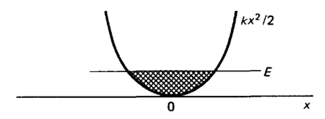
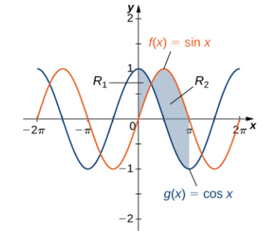

# AVP1214 — Single visual target

MathVista:997 / MathVista:287 · same type · Domain and solution-set constraints

## Shared or similar visual information

A shaded region with a plotted boundary. On the left, use the hatched region below E and above the bottom of the curve labeled kx²/2. On the right, use the shaded patch marked R2 between the orange sine and blue cosine traces at the right.

## Evidence locations

- Left image: The hatched region below E and above the bottom of the curve labeled kx²/2.
- Right image: The shaded patch marked R2 between the orange sine and blue cosine traces at the right.

## Mathematical meanings

Left image: Its horizontal footprint identifies where kx²/2 is below E, with equality at the two crossings. Right image: It selects a region between the two functions on the displayed x-interval.

## Same mathematical meanings

no

## Rationales

The left selection describes an allowable side or range relative to a plotted comparison. The right fill selects a gap between curves whose height is found by subtraction for an area calculation.

## Reasoning consequence

Correctly interpreting the markings means using the two crossings to delimit the x-values at which kx²/2 is less than E on the left and subtracting the lower graph from the upper graph over the displayed R2 interval on the right.

Only the selected target is annotated. AI visual-review draft; not independently double-annotated by humans.
