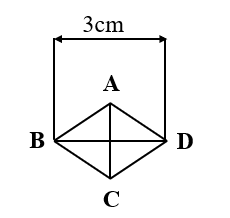
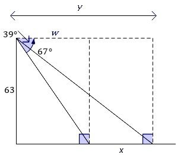

# AVP1215 — Single visual target

We-Math:1377 / MathVerse:359 · same type · Geometric markers

## Shared or similar visual information

A horizontal double-headed arrow separate from the coordinate axes.

## Evidence locations

- Left image: The horizontal arrow labeled 3 cm above the four-vertex figure.
- Right image: The double-headed horizontal arrow labeled y above the geometry.

## Mathematical meanings

Left image: The arrow gives the distance between B and D. Right image: The arrow gives the full horizontal span y of the construction.

## Same mathematical meanings

yes

## Rationales

Both images use the mark in the same way: the endpoints of the arrow delimit a spatial length on the construction.

Only the selected target is annotated. AI visual-review draft; not independently double-annotated by humans.
