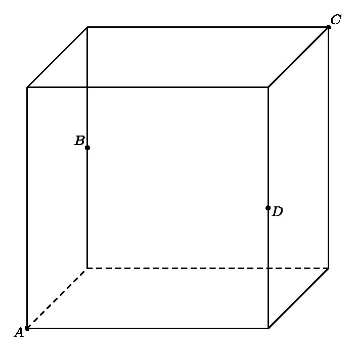

# AVP1217 — Single visual target

VisioMath:1703_A / MathVision:2163 · different type · Geometric markers

[Left image in official archive](https://raw.githubusercontent.com/Nefefilibata/VisioMath/4a912153e110001da261917902e1d3cc163b7c6a/data/images.zip) · `images/1703_A.jpg`

## Shared or similar visual information

A horizontal dashed line.

## Evidence locations

- Left image: The short horizontal dashed line leaving the y-axis at the radical expression.
- Right image: The dashed horizontal segment at the bottom rear of the box.

## Mathematical meanings

Left image: It indicates the plateau height at 6 + 2√3. Right image: The line depicts the hidden rear bottom edge of the solid.

## Same mathematical meanings

no

## Rationales

In the left image, the horizontal dashed segment projects a plotted point or plateau to its ordinate. In the right image, the dashes indicate a hidden horizontal edge of a solid.

Only the selected target is annotated. AI visual-review draft; not independently double-annotated by humans.
