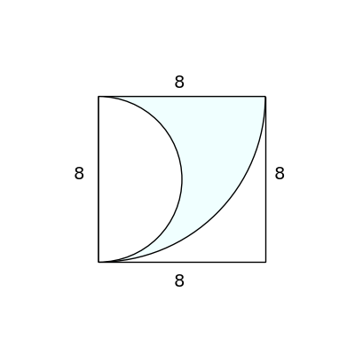
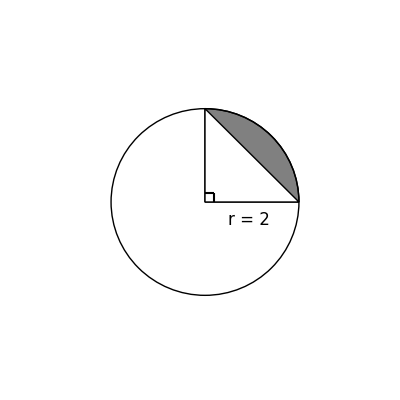

# AVP1217 — Single visual target

DynaMath:112 / DynaMath:97 · same type · Domain and solution-set constraints

## Shared or similar visual information

A shaded region with an adjacent unshaded interior cutout or excluded part. On the left, use the light-blue patch bounded by the larger arc, the left semicircle arc and the top side of the square. On the right, use the dark gray cap between the upper-right circular arc and the straight chord.

## Evidence locations

- Left image: The light-blue patch bounded by the larger arc, the left semicircle arc and the top side of the square.
- Right image: The dark gray cap between the upper-right circular arc and the straight chord.

## Mathematical meanings

Left image: It is the part inside the quarter disk and outside the white semicircle on its left. Right image: It is the quarter-sector with the unshaded right triangle removed.

## Same mathematical meanings

yes

## Rationales

The shade identifies the remainder after leaving designated pieces out of an enclosing geometric area. Those pieces must be removed from the area computation in each panel.

## Reasoning consequence

Correctly interpreting the markings means subtracting the white semicircle area from the enclosing quarter-disk area on the left and subtracting the triangle from the quarter-sector area on the right.

Only the selected target is annotated. AI visual-review draft; not independently double-annotated by humans.
