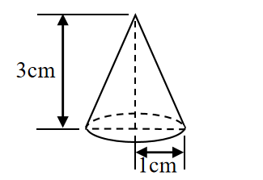
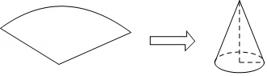

# AVP1218 — Single visual target

We-Math:1261 / MathVista:33 · same type · Geometric markers

## Shared or similar visual information

A dashed curve.

## Evidence locations

- Left image: The dashed curved arc near the cone base.
- Right image: The dashed rear arc of the cone base in the right-hand drawing.

## Mathematical meanings

Left image: The arc depicts the hidden rear half of the cone's base rim. Right image: The arc depicts the hidden part of the cone's base rim.

## Same mathematical meanings

yes

## Rationales

Both images use the mark in the same way: the dashes trace an occluded portion of a circular rim in a solid diagram.

Only the selected target is annotated. AI visual-review draft; not independently double-annotated by humans.
