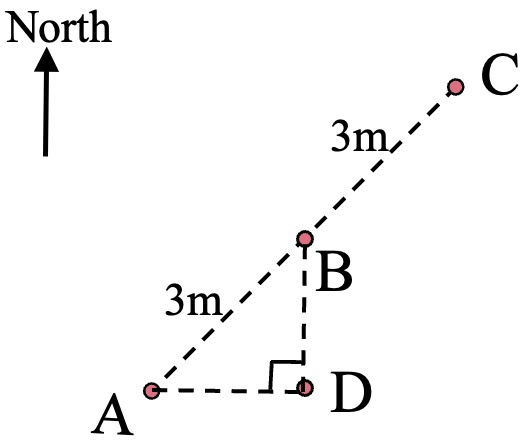
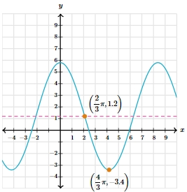

# AVP1219 — Single visual target

We-Math:1403 / MathVerse:535 · different type · Geometric markers

## Shared or similar visual information

An upward arrow on a straight vertical line.

## Evidence locations

- Left image: The upward arrow under North to the upper left of the dashed construction.
- Right image: The upward arrow above the scale on the axis labeled y.

## Mathematical meanings

Left image: The arrow gives the northerly reference for the relative positions. Right image: The arrow indicates the increasing vertical coordinate direction.

## Same mathematical meanings

no

## Rationales

In the left image, the arrow sets the compass-north reference for the geometry. In the right image, the arrow indicates the increasing direction of the vertical coordinate.

Only the selected target is annotated. AI visual-review draft; not independently double-annotated by humans.
