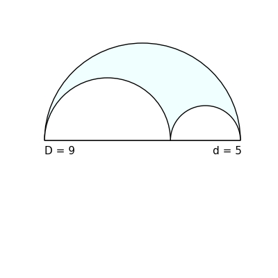
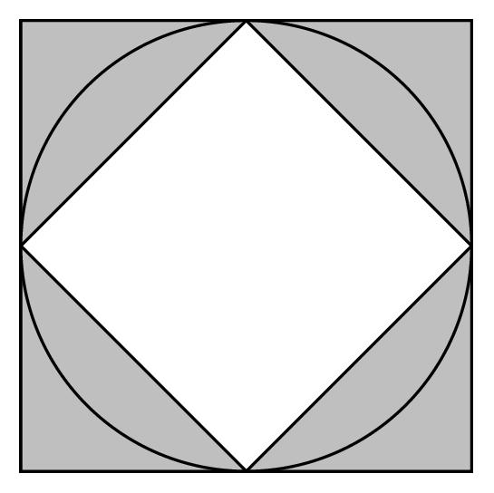

# AVP1219 — Single visual target

DynaMath:122 / MathVision:2717 · same type · Domain and solution-set constraints

## Shared or similar visual information

A shaded region with an adjacent unshaded interior cutout or excluded part. On the left, use the light-blue patch inside the large semicircle and above both smaller arcs. On the right, use the shaded parts inside the circle and outside the central white diamond.

## Evidence locations

- Left image: The light-blue patch inside the large semicircle and above both smaller arcs.
- Right image: The shaded parts inside the circle and outside the central white diamond.

## Mathematical meanings

Left image: It comprises the large semicircle minus the two unshaded smaller semicircles. Right image: The selected circular part is the disk with the inner square excluded. The additional corner shading is outside the circle.

## Same mathematical meanings

yes

## Rationales

The shade identifies the remainder after leaving designated pieces out of an enclosing geometric area. Those pieces must be removed from the area computation in each panel.

## Reasoning consequence

Correctly interpreting the markings means subtracting both smaller semicircle areas from the outer semicircle area on the left and using the diamond as an exclusion and omitting the shaded outer corners when calculating the circular area fraction on the right.

Only the selected target is annotated. AI visual-review draft; not independently double-annotated by humans.
