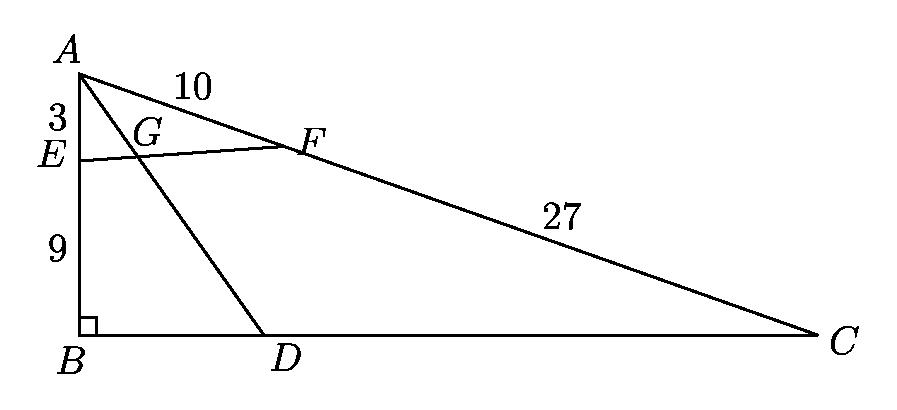
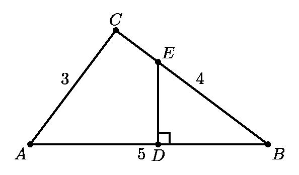

# AVP1220 — Single visual target

MathVision:2063 / MathVision:2180 · same type · Geometric markers

## Shared or similar visual information

A right-angle square.

## Evidence locations

- Left image: The square at B between the vertical side and the horizontal base.
- Right image: The square at D where ED joins AB.

## Mathematical meanings

Left image: AB is perpendicular to BC. Right image: ED is perpendicular to AB.

## Same mathematical meanings

yes

## Rationales

Both images use the mark in the same way: a square placed in the angle between two segments marks those segments as perpendicular.

Only the selected target is annotated. AI visual-review draft; not independently double-annotated by humans.
