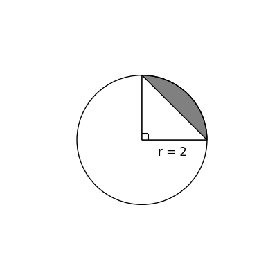
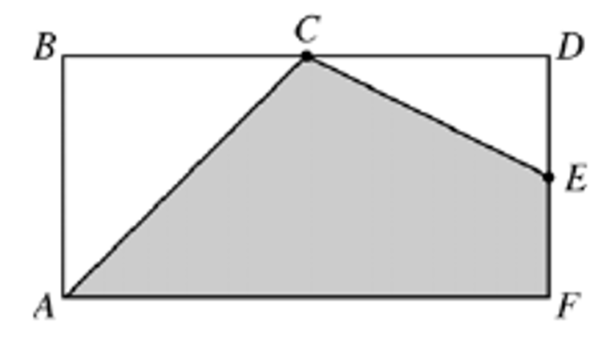

# AVP1221 — Single visual target

DynaMath:97 / MathVerse:767 · same type · Domain and solution-set constraints

## Shared or similar visual information

A shaded region with an adjacent unshaded interior cutout or excluded part. On the left, use the dark gray cap between the upper-right circular arc and the straight chord. On the right, use the gray polygon inside rectangle ABDF beneath the segments AC and CE.

## Evidence locations

- Left image: The dark gray cap between the upper-right circular arc and the straight chord.
- Right image: The gray polygon inside rectangle ABDF beneath the segments AC and CE.

## Mathematical meanings

Left image: It is the quarter-sector with the unshaded right triangle removed. Right image: It selects the part of the rectangle outside the two unshaded triangular pieces.

## Same mathematical meanings

yes

## Rationales

The shade identifies the remainder after leaving designated pieces out of an enclosing geometric area. Those pieces must be removed from the area computation in each panel.

## Reasoning consequence

Correctly interpreting the markings means subtracting the triangle from the quarter-sector area on the left and subtracting both unshaded triangles before dividing by the area of the whole rectangle on the right.

Only the selected target is annotated. AI visual-review draft; not independently double-annotated by humans.
