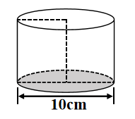

# AVP1222 — Single visual target

DynaMath:8 / We-Math:366 · same type · Geometric markers

## Shared or similar visual information

A dashed curve.

## Evidence locations

- Left image: The dashed arc between the sides near the bottom of the cone.
- Right image: The dashed back curve bordering the shaded bottom oval.

## Mathematical meanings

Left image: The arc depicts the hidden rear part of the cone base rim. Right image: The arc traces the hidden rear part of the cylinder base rim.

## Same mathematical meanings

yes

## Rationales

Both images use the mark in the same way: the dashes trace an occluded portion of a circular rim in a solid diagram.

Only the selected target is annotated. AI visual-review draft; not independently double-annotated by humans.
