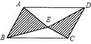

# AVP1225 — Single visual target

MathVerse:769 / MathVista:635 · same type · Domain and solution-set constraints

## Shared or similar visual information

Multiple filled pieces separated by unfilled parts of the surrounding figure. On the left, use the three gray triangles meeting the center, with white triangles between them. On the right, use the two hatched triangular regions ABE and DCE.

## Evidence locations

- Left image: The three gray triangles meeting the center, with white triangles between them.
- Right image: The two hatched triangular regions ABE and DCE.

## Mathematical meanings

Left image: The fill selects three separate triangles whose areas contribute to the shaded fraction. Right image: The hatch selects two separate triangles of parallelogram ABCD.

## Same mathematical meanings

yes

## Rationales

In each figure the fill specifies the components included in a total area. The unfilled pieces do not contribute to that total.

## Reasoning consequence

Correctly interpreting the markings means adding the areas of the three gray triangles before dividing by the rectangle area on the left and adding the two hatched triangle areas and leaving out the two unhatched triangles on the right.

Only the selected target is annotated. AI visual-review draft; not independently double-annotated by humans.
