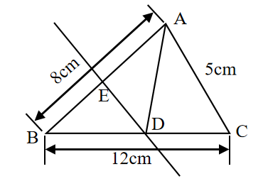

# AVP1225 — Single visual target

We-Math:1524 / MathVerse:546 · different type · Geometric markers

## Shared or similar visual information

A horizontal double-headed arrow separate from the coordinate axes.

## Evidence locations

- Left image: The double-headed horizontal arrow beneath the triangle.
- Right image: The magenta arrow joining the first two peaks near y = 50.

## Mathematical meanings

Left image: The arrow gives the base length BC of 12 cm. Right image: The arrow gives one period of the graph, from t = 1 to t = 5.

## Same mathematical meanings

no

## Rationales

In the left image, the endpoints of the arrow delimit a spatial length on the construction. In the right image, the arrow spans the horizontal distance between successive peaks of a periodic graph.

Only the selected target is annotated. AI visual-review draft; not independently double-annotated by humans.
