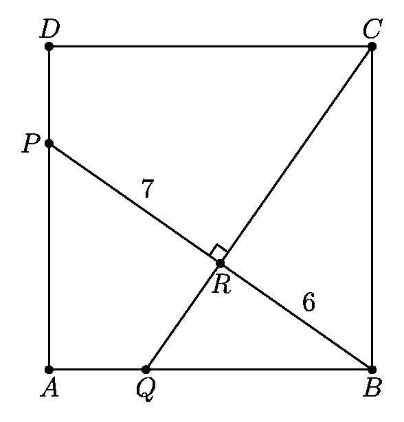

# AVP1226 — Single visual target

MathVision:2235 / We-Math:229 · same type · Geometric markers

## Shared or similar visual information

A right-angle square.

## Evidence locations

- Left image: The tilted square at R where the two oblique lines cross.
- Right image: The tilted square at triangle vertex A.

## Mathematical meanings

Left image: PB and QC are perpendicular. Right image: OA and AB are perpendicular at A.

## Same mathematical meanings

yes

## Rationales

Both images use the mark in the same way: a square placed in the angle between two segments marks those segments as perpendicular.

Only the selected target is annotated. AI visual-review draft; not independently double-annotated by humans.
