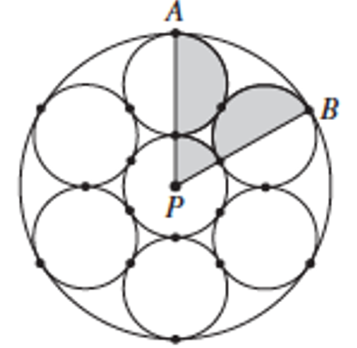
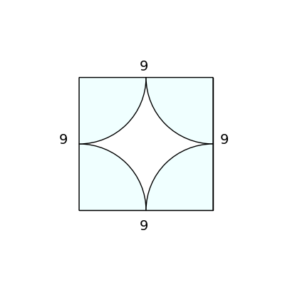

# AVP1226 — Single visual target

MathVerse:770 / DynaMath:153 · same type · Domain and solution-set constraints

## Shared or similar visual information

Multiple filled pieces separated by unfilled parts of the surrounding figure. On the left, use the gray portions of the inscribed circles near A and B, including the gray wedge at P. On the right, use the four light-blue sectors at the corners of the square.

## Evidence locations

- Left image: The gray portions of the inscribed circles near A and B, including the gray wedge at P.
- Right image: The four light-blue sectors at the corners of the square.

## Mathematical meanings

Left image: The fill picks out multiple parts of the small circles and excludes the surrounding white parts. Right image: The coloring selects the four quarter disks while excluding the white center.

## Same mathematical meanings

yes

## Rationales

In each figure the fill specifies the components included in a total area. The unfilled pieces do not contribute to that total.

## Reasoning consequence

Correctly interpreting the markings means summing the shaded sector and half-disk contributions instead of counting full circles on the left and combining the four equal sector areas into one disk area on the right.

Only the selected target is annotated. AI visual-review draft; not independently double-annotated by humans.
