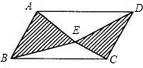
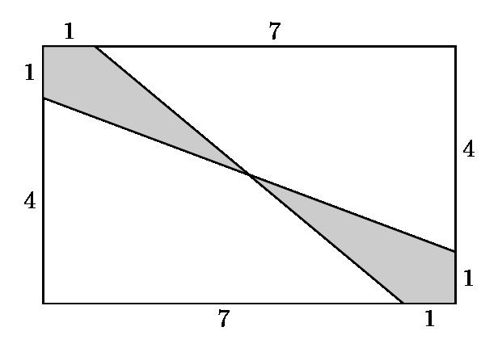

# AVP1227 — Single visual target

MathVista:635 / MathVision:2209 · same type · Domain and solution-set constraints

## Shared or similar visual information

Multiple filled pieces separated by unfilled parts of the surrounding figure. On the left, use the two hatched triangular regions ABE and DCE. On the right, use the gray patches at the upper-left and lower-right corners of the rectangle.

## Evidence locations

- Left image: The two hatched triangular regions ABE and DCE.
- Right image: The gray patches at the upper-left and lower-right corners of the rectangle.

## Mathematical meanings

Left image: The hatch selects two separate triangles of parallelogram ABCD. Right image: The fill selects two corner regions separated by unshaded parts of the rectangle.

## Same mathematical meanings

yes

## Rationales

In each figure the fill specifies the components included in a total area. The unfilled pieces do not contribute to that total.

## Reasoning consequence

Correctly interpreting the markings means adding the two hatched triangle areas and leaving out the two unhatched triangles on the left and adding the two gray corner areas without counting the rest of the rectangle on the right.

Only the selected target is annotated. AI visual-review draft; not independently double-annotated by humans.
