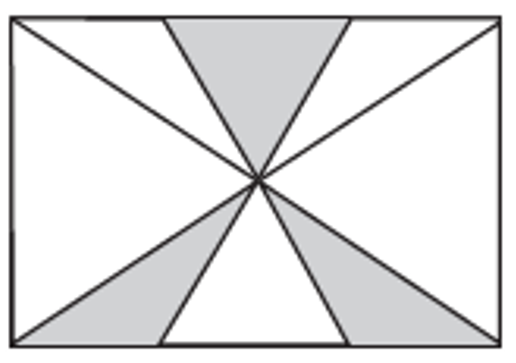

# AVP1228 — Single visual target

MathVerse:769 / VisioMath:1527_A · same type · Domain and solution-set constraints

[Right image in official archive](https://raw.githubusercontent.com/Nefefilibata/VisioMath/4a912153e110001da261917902e1d3cc163b7c6a/data/images.zip) · `images/1527_A.jpg`

## Shared or similar visual information

Multiple filled pieces separated by unfilled parts of the surrounding figure. On the left, use the three gray triangles meeting the center, with white triangles between them. On the right, use the dark triangle at the left and dark parallelogram at the lower right of the tangram runner.

## Evidence locations

- Left image: The three gray triangles meeting the center, with white triangles between them.
- Right image: The dark triangle at the left and dark parallelogram at the lower right of the tangram runner.

## Mathematical meanings

Left image: The fill selects three separate triangles whose areas contribute to the shaded fraction. Right image: The fill selects two separate tangram pieces for the shaded-area test.

## Same mathematical meanings

yes

## Rationales

In each figure the fill specifies the components included in a total area. The unfilled pieces do not contribute to that total.

## Reasoning consequence

Correctly interpreting the markings means adding the areas of the three gray triangles before dividing by the rectangle area on the left and adding those two tile areas before comparing the sum with the requested area on the right.

Only the selected target is annotated. AI visual-review draft; not independently double-annotated by humans.
