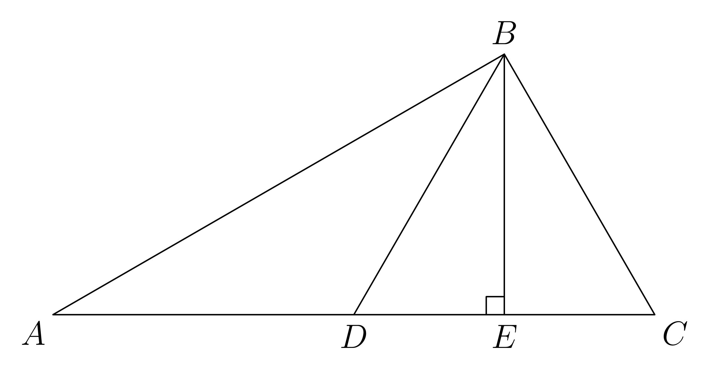

# AVP1229 — Single visual target

We-Math:995 / MathVision:2944 · same type · Geometric markers

## Shared or similar visual information

An unfilled square outline.

## Evidence locations

- Left image: The four-sided outline labeled A, B, C and D.
- Right image: The square at E where BE drops to AC.

## Mathematical meanings

Left image: The outline represents the square ABCD as the geometric object. Right image: BE is perpendicular to AC.

## Same mathematical meanings

no

## Rationales

In the left image, the outline itself bounds a square polygon. In the right image, a square placed in the angle between two segments marks those segments as perpendicular.

Only the selected target is annotated. AI visual-review draft; not independently double-annotated by humans.
