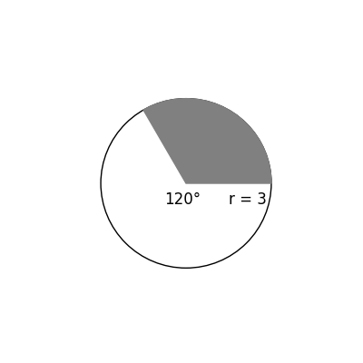
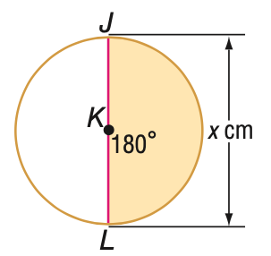

# AVP1231 — Single visual target

DynaMath:26 / MathVista:250 · same type · Domain and solution-set constraints

## Shared or similar visual information

A filled circular sector bounded by radial edges and an arc. On the left, use the dark gray sector enclosed by two radii and a circular arc, next to 120°. On the right, use the yellow half disk to the right of diameter JL, marked 180°.

## Evidence locations

- Left image: The dark gray sector enclosed by two radii and a circular arc, next to 120°.
- Right image: The yellow half disk to the right of diameter JL, marked 180°.

## Mathematical meanings

Left image: It selects the 120-degree sector as a geometric area. Right image: It selects half of the full disk as the area specified in the problem.

## Same mathematical meanings

yes

## Rationales

The sector label and bounded fill determine a fraction of the entire disk area on each side.

## Reasoning consequence

Correctly interpreting the markings means using the sector fraction 120°/360° when calculating the shaded part on the left and setting the area of a half disk equal to the given area when finding its diameter on the right.

Only the selected target is annotated. AI visual-review draft; not independently double-annotated by humans.
