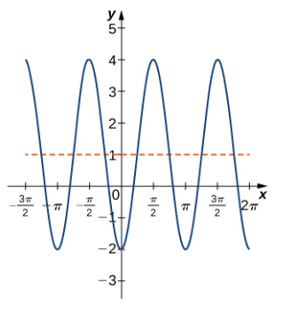
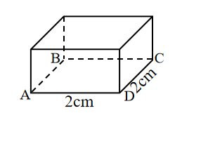

# AVP1232 — Single visual target

MathVista:592 / We-Math:1259 · different type · Geometric markers

## Shared or similar visual information

A horizontal dashed line.

## Evidence locations

- Left image: The orange dashed horizontal line crossing the wave at y = 1.
- Right image: The dashed horizontal line joining B and C.

## Mathematical meanings

Left image: The line gives the vertical midpoint of the plotted wave at y = 1. Right image: The line depicts the hidden back bottom edge BC of the cuboid.

## Same mathematical meanings

no

## Rationales

In the left image, the dashed line gives the midline about which a wave oscillates. In the right image, the dashes indicate a hidden horizontal edge of a solid.

Only the selected target is annotated. AI visual-review draft; not independently double-annotated by humans.
