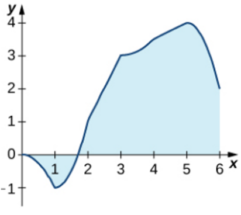

# AVP1234 — Single visual target

VisioMath:1247_A / MathVista:260 · different type · Domain and solution-set constraints

[Left image in official archive](https://raw.githubusercontent.com/Nefefilibata/VisioMath/4a912153e110001da261917902e1d3cc163b7c6a/data/images.zip) · `images/1247_A.jpg`

## Shared or similar visual information

An x-axis-adjacent shaded region near a plotted curve. On the left, use the gray triangle bounded by the x-axis, segment ON and the vertical segment below N. On the right, use the larger blue region above the x-axis from the positive crossing to the right edge at x = 6.

## Evidence locations

- Left image: The gray triangle bounded by the x-axis, segment ON and the vertical segment below N.
- Right image: The larger blue region above the x-axis from the positive crossing to the right edge at x = 6.

## Mathematical meanings

Left image: The selected triangle has vertex N on the hyperbola, and straight boundaries to its projection and the origin. Right image: It selects the portion of the area measured between the upper curve and the x-axis over the indicated interval.

## Same mathematical meanings

no

## Rationales

The left shaded patch is bounded by the straight segment from O to N. The right shaded patch reaches a function curve itself, which supplies an area boundary throughout its interval.

## Reasoning consequence

Correctly interpreting the markings means using the coordinates of N to compute that triangle’s area on the left and using x = 6 as the right bound and separating the above-axis patch from the negative lobe on the right.

Only the selected target is annotated. AI visual-review draft; not independently double-annotated by humans.
