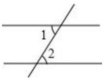
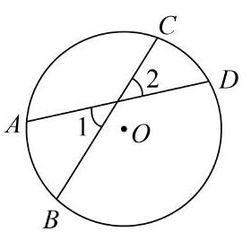

# AVP1236 — Single visual target

MV-MATH:1086_1 / MV-MATH:221_1 · same type · Numeric representation and conversion

## Shared or similar visual information

The bare numeral 1.

## Evidence locations

- Left image: The notation 1 appears left of the upper crossing.
- Right image: The notation 1 appears beside the lower-left arc at the chord intersection.

## Mathematical meanings

Left image: 1 names the marked angle below the upper horizontal line. Right image: 1 names the selected angle at the chord intersection.

## Same mathematical meanings

yes

## Rationales

The bare numeral 1 is associated with an angle in both drawings and identifies which angle is referenced.

Only the selected target is annotated. AI visual-review draft; not independently double-annotated by humans.
