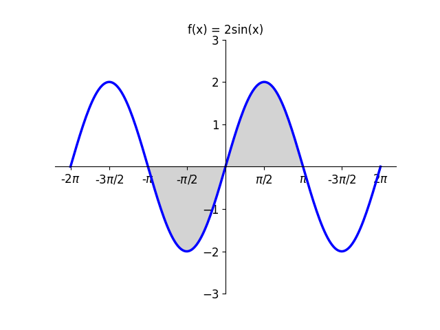

# AVP1238 — Single visual target

VisioMath:1506_A / DynaMath:77 · different type · Domain and solution-set constraints

[Left image in official archive](https://raw.githubusercontent.com/Nefefilibata/VisioMath/4a912153e110001da261917902e1d3cc163b7c6a/data/images.zip) · `images/1506_A.jpg`

## Shared or similar visual information

A gray-filled portion of a plane diagram. On the left, use the chain of six gray unit cells in the rectangular grid. On the right, use the gray positive lobe between the sine curve and the x-axis from 0 to π.

## Evidence locations

- Left image: The chain of six gray unit cells in the rectangular grid.
- Right image: The gray positive lobe between the sine curve and the x-axis from 0 to π.

## Mathematical meanings

Left image: The six marked unit squares make up the figure available for cutting and rearrangement. Right image: It selects the area bounded by the upper sine lobe and the horizontal axis.

## Same mathematical meanings

no

## Rationales

The left fill identifies a discrete collection of movable or occupied cells. The right fill identifies a continuous region up to a plotted boundary, requiring a graph-based area calculation.

## Reasoning consequence

Correctly interpreting the markings means keeping only those six cells as the pieces of the candidate rearrangement on the left and integrating over the positive lobe from 0 to π when calculating that part of the area on the right.

Only the selected target is annotated. AI visual-review draft; not independently double-annotated by humans.
