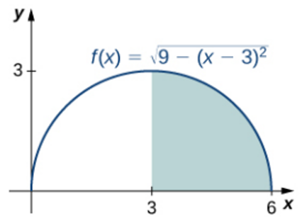

# AVP1239 — Single visual target

VisioMath:1405_A / MathVista:671 · different type · Domain and solution-set constraints

[Left image in official archive](https://raw.githubusercontent.com/Nefefilibata/VisioMath/4a912153e110001da261917902e1d3cc163b7c6a/data/images.zip) · `images/1405_A.jpg`

## Shared or similar visual information

A gray-filled portion of a plane diagram. On the left, use the selected gray unit cells of the four-by-four grid. On the right, use the blue-green fill under the right branch of the semicircle, to the right of x = 3.

## Evidence locations

- Left image: The selected gray unit cells of the four-by-four grid.
- Right image: The blue-green fill under the right branch of the semicircle, to the right of x = 3.

## Mathematical meanings

Left image: The cells marked gray specify a finite collection of occupied squares of the candidate shape. Right image: It selects the region under the arch only from x = 3 to x = 6.

## Same mathematical meanings

no

## Rationales

The left fill identifies a discrete collection of movable or occupied cells. The right fill identifies a continuous region up to a plotted boundary, requiring a graph-based area calculation.

## Reasoning consequence

Correctly interpreting the markings means checking the symmetry of the occupied-cell pattern on the left and using the restricted upper interval from 3 to 6 for the shaded area on the right.

Only the selected target is annotated. AI visual-review draft; not independently double-annotated by humans.
