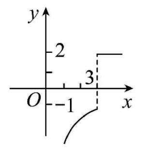

# AVP1239 — Single visual target

MathVista:308 / MV-MATH:94_1 · same type · Numeric representation and conversion

## Shared or similar visual information

The numerical notations 1.0 (left) and −1 (right).

## Evidence locations

- Left image: The notation 1.0 appears at the highest numbered vertical-axis tick.
- Right image: The notation −1 appears at the marked tick below the horizontal axis.

## Mathematical meanings

Left image: 1.0 is a vertical-axis coordinate. Right image: −1 is a vertical coordinate below the origin.

## Same mathematical meanings

no

## Rationales

The numeric forms have opposite signs (1.0 and −1), so they denote different values in the same mathematical role.

Only the selected target is annotated. AI visual-review draft; not independently double-annotated by humans.
