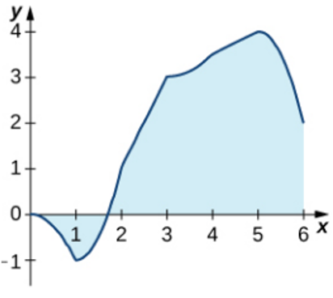

# AVP1240 — Single visual target

VisioMath:1506_A / MathVista:260 · different type · Domain and solution-set constraints

[Left image in official archive](https://raw.githubusercontent.com/Nefefilibata/VisioMath/4a912153e110001da261917902e1d3cc163b7c6a/data/images.zip) · `images/1506_A.jpg`

## Shared or similar visual information

A gray-filled portion of a plane diagram. On the left, use the chain of six gray unit cells in the rectangular grid. On the right, use the larger blue region above the x-axis from the positive crossing to the right edge at x = 6.

## Evidence locations

- Left image: The chain of six gray unit cells in the rectangular grid.
- Right image: The larger blue region above the x-axis from the positive crossing to the right edge at x = 6.

## Mathematical meanings

Left image: The six marked unit squares make up the figure available for cutting and rearrangement. Right image: It selects the portion of the area measured between the upper curve and the x-axis over the indicated interval.

## Same mathematical meanings

no

## Rationales

The left fill identifies a discrete collection of movable or occupied cells. The right fill identifies a continuous region up to a plotted boundary, requiring a graph-based area calculation.

## Reasoning consequence

Correctly interpreting the markings means keeping only those six cells as the pieces of the candidate rearrangement on the left and using x = 6 as the right bound and separating the above-axis patch from the negative lobe on the right.

Only the selected target is annotated. AI visual-review draft; not independently double-annotated by humans.
