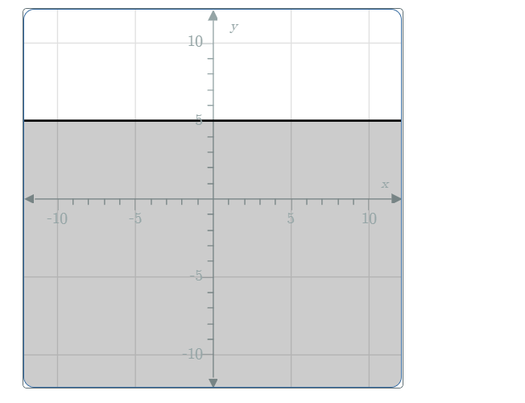
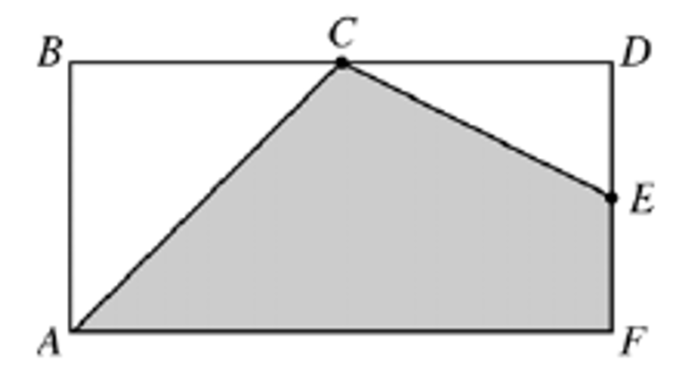

# AVP1241 — Single visual target

MathVerse:509 / MathVerse:767 · different type · Domain and solution-set constraints

## Shared or similar visual information

A fill selecting one side of a visible geometric or plotted boundary. On the left, use the gray half-plane below the solid horizontal line. On the right, use the gray polygon inside rectangle ABDF beneath the segments AC and CE.

## Evidence locations

- Left image: The gray half-plane below the solid horizontal line.
- Right image: The gray polygon inside rectangle ABDF beneath the segments AC and CE.

## Mathematical meanings

Left image: It consists of points satisfying the lower-side inequality, including equality along the solid line. Right image: It selects the part of the rectangle outside the two unshaded triangular pieces.

## Same mathematical meanings

no

## Rationales

The shaded half-plane records which coordinate pairs meet an inequality. The geometric fill delimits a measured area after removing the depicted cutout or excluded portion.

## Reasoning consequence

Correctly interpreting the markings means including points on the boundary and below it in the solution set on the left and subtracting both unshaded triangles before dividing by the area of the whole rectangle on the right.

Only the selected target is annotated. AI visual-review draft; not independently double-annotated by humans.
