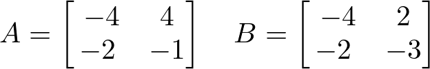
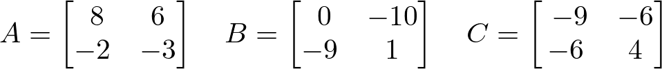

# AVP1242 — Single visual target

DynaMath:475 / DynaMath:487 · same type · Numeric representation and conversion

## Shared or similar visual information

The numerical notations 2 (left) and −2 (right).

## Evidence locations

- Left image: The notation 2 appears top-right cell of matrix B.
- Right image: The notation −2 appears bottom-left cell of matrix A.

## Mathematical meanings

Left image: 2 is the top-right entry of B. Right image: −2 is the bottom-left entry of A.

## Same mathematical meanings

no

## Rationales

The numeric forms have opposite signs (2 and −2), so they denote different values in the same mathematical role.

Only the selected target is annotated. AI visual-review draft; not independently double-annotated by humans.
