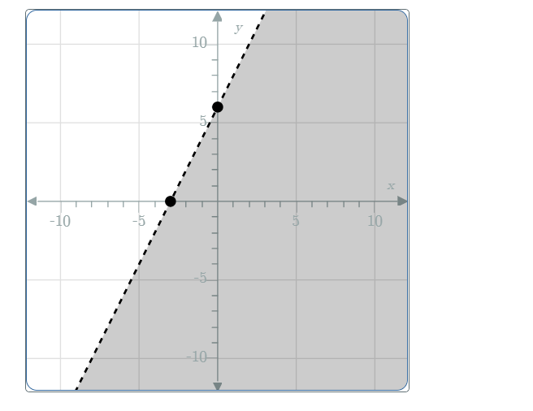

# AVP1243 — Single visual target

MathVerse:511 / DynaMath:53 · different type · Domain and solution-set constraints

## Shared or similar visual information

A fill selecting one side of a visible geometric or plotted boundary. On the left, use the gray side of the rising dashed line that contains the origin. On the right, use the light-blue ring between the two concentric circles.

## Evidence locations

- Left image: The gray side of the rising dashed line that contains the origin.
- Right image: The light-blue ring between the two concentric circles.

## Mathematical meanings

Left image: It marks the open half-plane of coordinate pairs satisfying the strict linear inequality. Right image: It is the part of the disk of radius 7 outside the disk of radius 5.

## Same mathematical meanings

no

## Rationales

The shaded half-plane records which coordinate pairs meet an inequality. The geometric fill delimits a measured area after removing the depicted cutout or excluded portion.

## Reasoning consequence

Correctly interpreting the markings means including the origin while excluding the points on the dashed line on the left and using the difference of the two disk areas on the right.

Only the selected target is annotated. AI visual-review draft; not independently double-annotated by humans.
