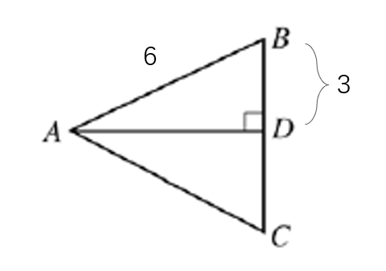

# AVP1244 — Single visual target

DynaMath:492 / MathVerse:758 · different type · Numeric representation and conversion

## Shared or similar visual information

The numerical notation 3.

## Evidence locations

- Left image: The notation 3 appears in the term 3x on the second line.
- Right image: The notation 3 appears next to the brace joining B and D.

## Mathematical meanings

Left image: 3 multiplies x in the second linear equation. Right image: 3 is the length BD along the right vertical side.

## Same mathematical meanings

no

## Rationales

The notation on the left represents a variable coefficient. The notation on the right represents a segment length.

Only the selected target is annotated. AI visual-review draft; not independently double-annotated by humans.
