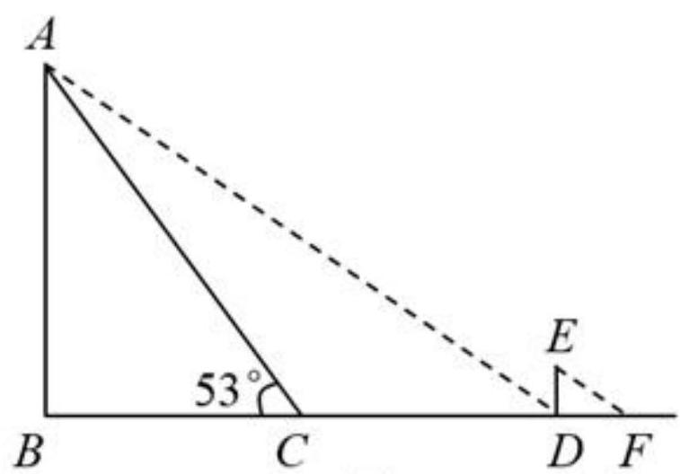
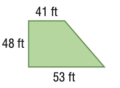

# AVP1245 — Single visual target

MV-MATH:1905_2 / MathVista:318 · same type · Numeric representation and conversion

## Shared or similar visual information

The numerical notations 53° (left) and 53 ft (right).

## Evidence locations

- Left image: The notation 53° appears beside the arc at C.
- Right image: The notation 53 ft appears below the trapezoid.

## Mathematical meanings

Left image: 53° measures the marked angle between CA and CB. Right image: 53 ft gives the lower base length.

## Same mathematical meanings

no

## Rationales

The notation on the left represents an angle measure. The notation on the right represents a segment length.

Only the selected target is annotated. AI visual-review draft; not independently double-annotated by humans.
