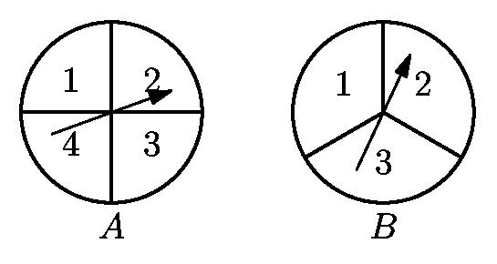

# AVP1247 — Single visual target

MathVista:250 / MathVision:2658 · same type · Domain and solution-set constraints

## Shared or similar visual information

A sector of a circle bounded by two radii and a circular arc. On the left, use the yellow half disk to the right of diameter JL, marked 180°. On the right, use the sector labeled 2 on spinner A.

## Evidence locations

- Left image: The yellow half disk to the right of diameter JL, marked 180°.
- Right image: The sector labeled 2 on spinner A.

## Mathematical meanings

Left image: It selects half of the full disk as the area specified in the problem. Right image: This sector is one of the possible numerical outcomes of spinner A.

## Same mathematical meanings

no

## Rationales

The left sector defines a geometric area to measure. The numeral inside the right sector is an outcome of a spinner, which enters a probability calculation.

## Reasoning consequence

Correctly interpreting the markings means setting the area of a half disk equal to the given area when finding its diameter on the left and using outcome 2 from A as one input to the probability calculation on the right.

Only the selected target is annotated. AI visual-review draft; not independently double-annotated by humans.
