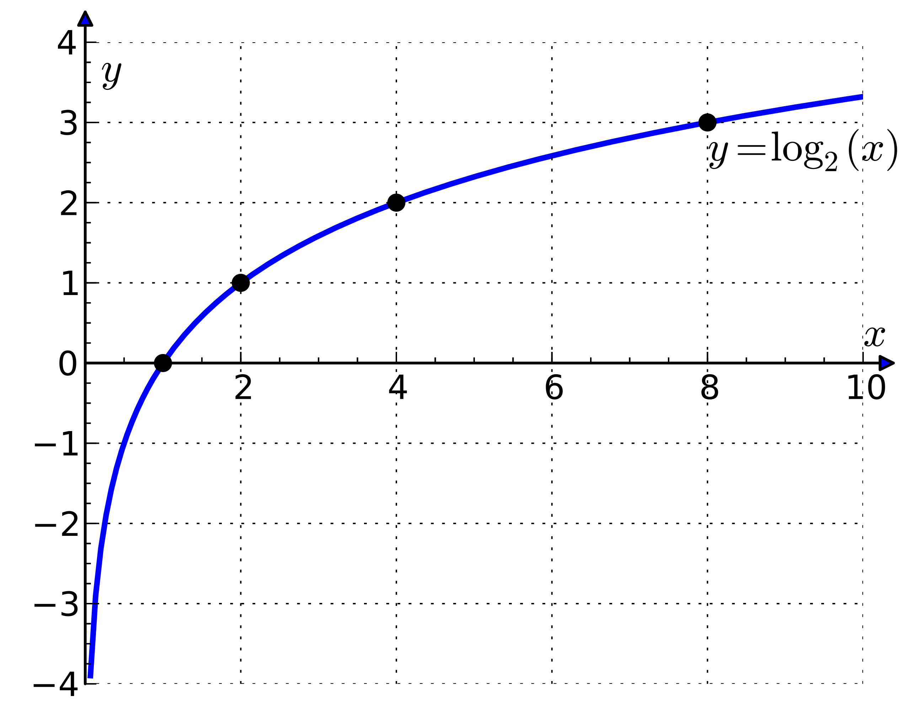
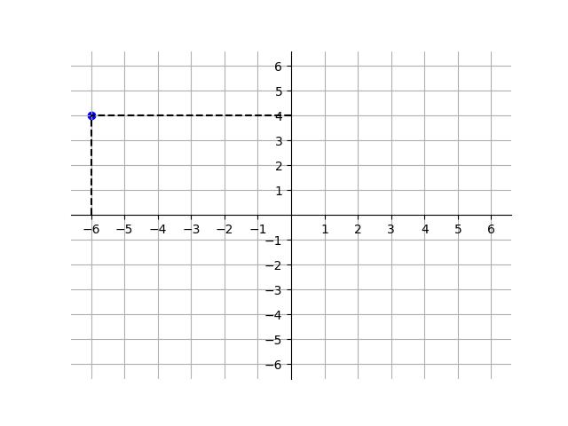

# AVP1247 — Single visual target

MathVista:329 / DynaMath:363 · different type · Numeric representation and conversion

## Shared or similar visual information

The numerical notations 6 (left) and −6 (right).

## Evidence locations

- Left image: The notation 6 appears below the horizontal axis between labels 4 and 8.
- Right image: The notation −6 appears at the foot of the dashed vertical projection.

## Mathematical meanings

Left image: 6 gives the horizontal-axis input at that tick. Right image: −6 is the horizontal coordinate of the blue point.

## Same mathematical meanings

no

## Rationales

The numeric forms have opposite signs (6 and −6), so they denote different values in the same mathematical role.

Only the selected target is annotated. AI visual-review draft; not independently double-annotated by humans.
