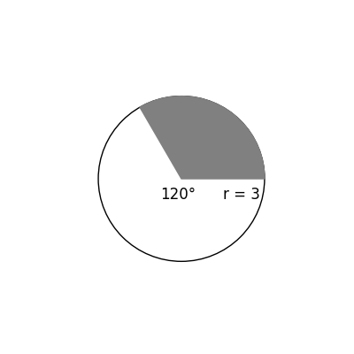
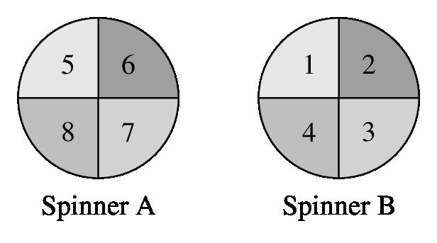

# AVP1248 — Single visual target

DynaMath:26 / MathVision:2775 · same type · Domain and solution-set constraints

## Shared or similar visual information

A sector of a circle bounded by two radii and a circular arc. On the left, use the dark gray sector enclosed by two radii and a circular arc, next to 120°. On the right, use the dark upper-right quarter of spinner A, labeled 6.

## Evidence locations

- Left image: The dark gray sector enclosed by two radii and a circular arc, next to 120°.
- Right image: The dark upper-right quarter of spinner A, labeled 6.

## Mathematical meanings

Left image: It selects the 120-degree sector as a geometric area. Right image: This sector is the outcome that supplies the tens digit 6 in N.

## Same mathematical meanings

no

## Rationales

The left sector defines a geometric area to measure. The numeral inside the right sector is an outcome of a spinner, which enters a probability calculation.

## Reasoning consequence

Correctly interpreting the markings means using the sector fraction 120°/360° when calculating the shaded part on the left and using 6 from spinner A as the tens digit in the two-spinner outcome on the right.

Only the selected target is annotated. AI visual-review draft; not independently double-annotated by humans.
