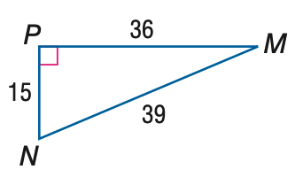

# AVP1248 — Single visual target

MathVerse:527 / MathVista:388 · same type · Numeric representation and conversion

## Shared or similar visual information

The numerical notations π/5 (left) and 36 (right).

## Evidence locations

- Left image: The notation π/5 appears beside the marked opening from the negative horizontal ray to OA.
- Right image: The notation 36 appears above PM.

## Mathematical meanings

Left image: π/5 radians measures the indicated angle at the origin. Right image: 36 gives the length of the horizontal leg PM.

## Same mathematical meanings

no

## Rationales

The notation on the left represents an angle measure. The notation on the right represents a segment length.

Only the selected target is annotated. AI visual-review draft; not independently double-annotated by humans.
