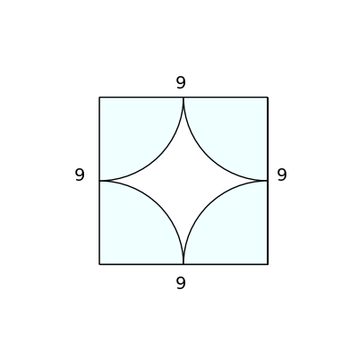
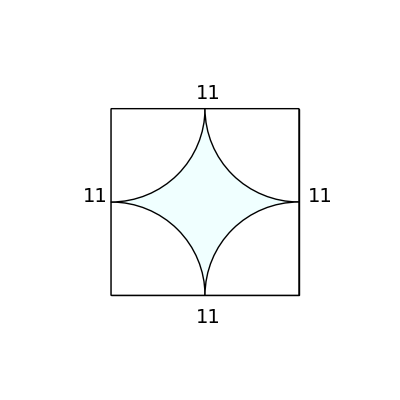

# AVP1249 — Single visual target

DynaMath:153 / DynaMath:154 · same type · Domain and solution-set constraints

## Shared or similar visual information

Shading restricted to parts of a figure by internal boundaries. On the left, use the four light-blue sectors at the corners of the square. On the right, use the light-blue center of the square bordered by four unshaded corner sectors.

## Evidence locations

- Left image: The four light-blue sectors at the corners of the square.
- Right image: The light-blue center of the square bordered by four unshaded corner sectors.

## Mathematical meanings

Left image: The coloring selects the four quarter disks while excluding the white center. Right image: It selects the center remaining after removing the four corner sectors from the square.

## Same mathematical meanings

no

## Rationales

The left fill selects separated pieces whose areas are accumulated. The right fill selects a connected remainder after excluding the adjacent unshaded pieces.

## Reasoning consequence

Correctly interpreting the markings means combining the four equal sector areas into one disk area on the left and subtracting the four corner-sector areas to obtain the shaded remainder on the right.

Only the selected target is annotated. AI visual-review draft; not independently double-annotated by humans.
