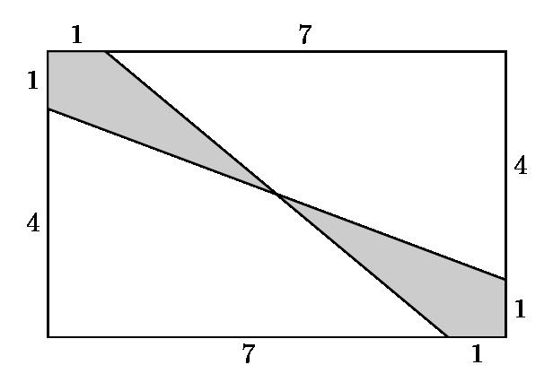
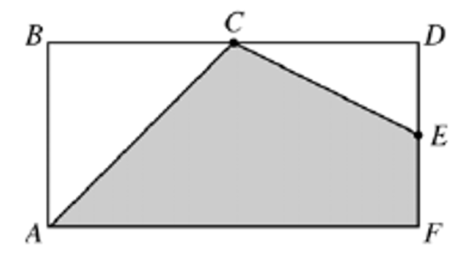

# AVP1250 — Single visual target

MathVision:2209 / MathVerse:767 · same type · Domain and solution-set constraints

## Shared or similar visual information

Shading restricted to parts of a figure by internal boundaries. On the left, use the gray patches at the upper-left and lower-right corners of the rectangle. On the right, use the gray polygon inside rectangle ABDF beneath the segments AC and CE.

## Evidence locations

- Left image: The gray patches at the upper-left and lower-right corners of the rectangle.
- Right image: The gray polygon inside rectangle ABDF beneath the segments AC and CE.

## Mathematical meanings

Left image: The fill selects two corner regions separated by unshaded parts of the rectangle. Right image: It selects the part of the rectangle outside the two unshaded triangular pieces.

## Same mathematical meanings

no

## Rationales

The left fill selects separated pieces whose areas are accumulated. The right fill selects a connected remainder after excluding the adjacent unshaded pieces.

## Reasoning consequence

Correctly interpreting the markings means adding the two gray corner areas without counting the rest of the rectangle on the left and subtracting both unshaded triangles before dividing by the area of the whole rectangle on the right.

Only the selected target is annotated. AI visual-review draft; not independently double-annotated by humans.
