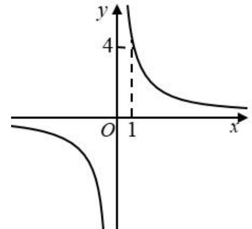
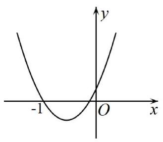

# AVP1253 — Single visual target

MV-MATH:952_1 / MV-MATH:85_1 · same type · Numeric representation and conversion

## Shared or similar visual information

The numerical notations 1 (left) and −1 (right).

## Evidence locations

- Left image: The notation 1 appears below the vertical projection of a point on the right branch.
- Right image: The notation −1 appears at the left intercept.

## Mathematical meanings

Left image: 1 is the horizontal coordinate of the point indicated by the guide. Right image: −1 is the horizontal coordinate of the left zero.

## Same mathematical meanings

no

## Rationales

The numeric forms have opposite signs (1 and −1), so they denote different values in the same mathematical role.

Only the selected target is annotated. AI visual-review draft; not independently double-annotated by humans.
