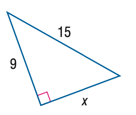
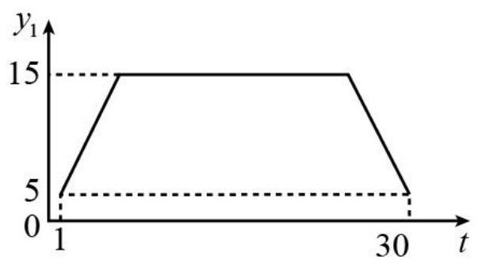

# AVP1254 — Single visual target

MathVista:160 / MV-MATH:101_1 · different type · Numeric representation and conversion

## Shared or similar visual information

The numerical notation 15.

## Evidence locations

- Left image: The notation 15 appears above the sloping side opposite the right-angle mark.
- Right image: The notation 15 appears on the y₁-axis at the level of the plateau.

## Mathematical meanings

Left image: 15 is the hypotenuse length. Right image: 15 gives the output along the plateau.

## Same mathematical meanings

no

## Rationales

The notation on the left represents a hypotenuse length. The notation on the right represents a vertical coordinate.

Only the selected target is annotated. AI visual-review draft; not independently double-annotated by humans.
