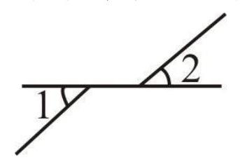
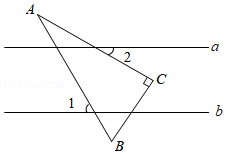

# AVP1255 — Single visual target

MV-MATH:481_1 / MathVista:736 · same type · Numeric representation and conversion

## Shared or similar visual information

The bare numeral 2.

## Evidence locations

- Left image: The notation 2 appears above the horizontal line at the right intersection.
- Right image: The notation 2 appears beside the arc at the intersection with line a.

## Mathematical meanings

Left image: 2 names the marked right angle. Right image: 2 names the marked angle below line a.

## Same mathematical meanings

yes

## Rationales

The bare numeral 2 is associated with an angle in both drawings and identifies which angle is referenced.

Only the selected target is annotated. AI visual-review draft; not independently double-annotated by humans.
